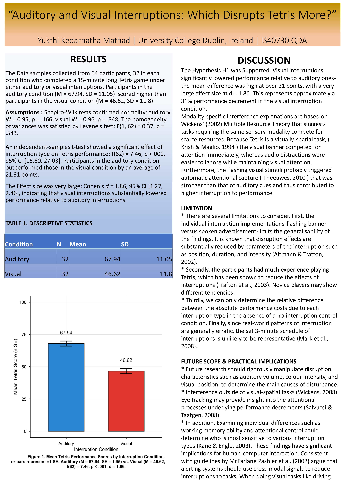

# Auditory vs Visual Interruptions: Which Disrupts Tetris More?

A quantitative data analysis in R comparing how auditory and visual interruptions affect performance on a visual-spatial task (Tetris). Completed for IS40730 Quantitative Data Analysis, University College Dublin.

## Key findings
- **64 participants**, 32 per condition (between-subjects design)
- Auditory condition: **M = 67.94**, SD = 11.05; Visual condition: **M = 46.62**, SD = 11.80
- Independent-samples t-test: **t(62) = 7.46, p < .001**, 95% CI [15.60, 27.03]
- Effect size: **Cohen's d = 1.86** (very large), a roughly 31% performance drop under visual interruptions
- Consistent with Wickens' Multiple Resource Theory: a visual interruption competes with a visual task for the same attentional resources

## Analysis steps
1. **Data cleaning:** missing values, duplicates, out-of-range scores, outlier check
2. **Descriptive statistics:** by condition, with histograms, boxplots and a mean ± SE bar chart
3. **Assumption checks:** Shapiro-Wilk and Q-Q plots for normality; Levene's test for equal variances
4. **Inferential test:** independent-samples t-test
5. **Effect size:** Cohen's d with confidence interval

## Tools
R: tidyverse (dplyr, ggplot2), psych, car, effsize

## Files
- `analysis.R`: full analysis script
- `poster/poster.pdf`: academic poster with results, discussion, limitations and references

## Run it
Install the packages, put `tetris.csv` in the same folder as the script, update the `setwd()` line to that folder, then run `analysis.R`.
